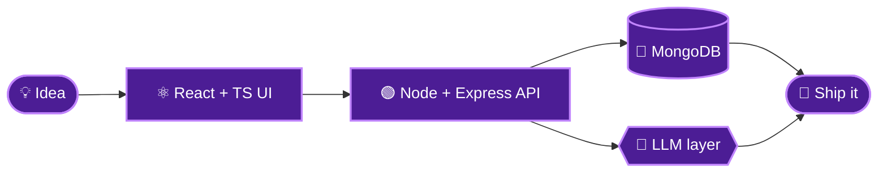
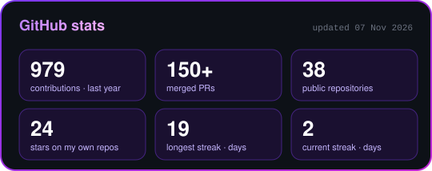
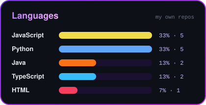

<div align="center">




<a href="https://github.com/Shruti070107">
  
</a>

<br/>

<a href="https://www.linkedin.com/in/shruti-singh-747b90344"></a>
<a href="mailto:shruti070107@gmail.com"></a>
<a href="https://www.geeksforgeeks.org/profile/shruti0gvot"></a>
<a href="https://codolio.com/profile/ShrutiSingh2007"></a>

<br/><br/>


</div>



## 🧬 whoami

```ts
const shruti = {
  role: "Full-Stack Developer",
  stack: ["React", "TypeScript", "Node.js", "Express", "MongoDB"],
  superpower: "taking an idea from schema to shipped UI",
  experience: "Full-Stack Intern @ Codec Technologies",
  curious: ["AI/LLM integrations", "developer tools", "open source"],
  openSource: { mergedPRs: "150+", programs: ["ECSOC", "SSOC 2026", "GSSOC 2026"] },
  hackathons: { won: 1, nationalFinalist: 2 },
  mission: "turn ideas into products people can actually use",
};
```


## ⚙️ How I build



<div align="center">


</div>


## 🌍 Open Source Arena

<div align="center">


<br/><br/>

<table>
  <tr>
    <td align="center" width="220">
      <h3>🟣 ECSOC</h3>
      <sub>Contributor</sub>
    </td>
    <td align="center" width="220">
      <h3>🔮 SSOC 2026</h3>
      <sub>Participant</sub>
    </td>
    <td align="center" width="220">
      <h3>🛡️ GSSOC 2026</h3>
      <sub>Project Admin</sub>
    </td>
  </tr>
</table>

</div>


## 🏆 Trophy Cabinet

<div align="center">

<table>
  <tr>
    <td align="center" width="330">
      <h3>🥇 Hackathon Winner</h3>
      <b>Innovation Odyssey</b>
    </td>
    <td align="center" width="330">
      <h3>🎯 National-Level Finalist</h3>
      <b>EliteHer</b> &nbsp;·&nbsp; <b>Drophack</b>
    </td>
  </tr>
</table>

</div>


## 🚀 Build Log

<div align="center">

<table>
  <tr>
    <td width="50%" valign="top">
      <h3>💸 PulsePay</h3>
      <p>AI-powered payment recovery and intelligence platform.</p>
      <a href="https://github.com/Shruti070107/PulsePay"></a>
    </td>
    <td width="50%" valign="top">
      <h3>🌿 ReGenX</h3>
      <p>Real-time bio-waste logistics, ESG verification and carbon intelligence platform.</p>
      <a href="https://github.com/Shruti070107/ReGenX"></a>
    </td>
  </tr>
  <tr>
    <td width="50%" valign="top">
      <h3>⛰️ NER Landslide Watch</h3>
      <p>Landslide risk monitoring and early-warning platform.</p>
      <a href="https://github.com/Shruti070107/NER-Landslide-Guard"></a>
    </td>
    <td width="50%" valign="top">
      <h3>🔍 CodeLens</h3>
      <p>AI-powered code intelligence and security platform.</p>
      <a href="https://github.com/Shruti070107/CodeLens"></a>
    </td>
  </tr>
</table>

</div>


## 📊 Stats

<div align="center">




<br/><br/>



</div>


<div align="center">

<a href="https://www.linkedin.com/in/shruti-singh-747b90344"></a>
<a href="https://github.com/Shruti070107"></a>
<a href="mailto:shruti070107@gmail.com"></a>


<sub>Build. Ship. Merge. Repeat. 💜</sub>

</div>
